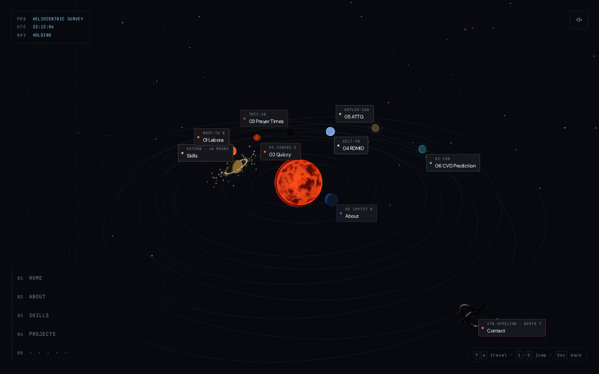

# Portfolio Universe

**Live: [gawad-b.github.io](https://gawad-b.github.io)**

An interactive 3D portfolio where the space scene *is* the navigation: one star system in which every body is real content. The About page is a planet, 48 skills orbit Saturn as labeled moons, six projects form an exoplanet belt, and Contact means docking with a ship parked at a station on the system's edge. Scrolling flies the camera between them.



## Technology & Why

| Technology | Where it's used | Why it was chosen |
|---|---|---|
| **TypeScript** (strict) | Everything in `src/` | The scene, camera, and UI share one state machine — strict types catch cross-layer mistakes at compile time. |
| **React 18 + Vite 6** | App shell, HUD, overlays (`src/App.tsx`, `src/ui/`) | Declarative UI over the canvas; Vite gives instant HMR in dev and a small static bundle out. |
| **three.js** | The universe itself (`src/scene/`) | The standard for WebGL — sun, planets, rings, moons, station, and ship are all three.js scene graph. |
| **React Three Fiber + drei** | Scene components (`src/scene/*.tsx`), the cockpit monitor (`src/regions/MilanoInterior.tsx`) | Lets 3D objects be React components sharing state with the UI; drei's `<Html transform>` projects the real DOM contact form onto the cockpit screen. |
| **Custom GLSL shaders** | `src/scene/shaders/` — star granulation, planet surfaces (fBm/ridged noise), atmospheres, rings with analytic shadow | The site ships **zero texture or model files**: every surface is computed on the GPU, so the whole experience downloads in ~300 KB. |
| **@react-three/postprocessing** | Bloom + vignette (`src/scene/Universe.tsx`) | The cinematic glow on emissives (star, beacons, station windows), tiered down or off on weaker GPUs. |
| **Zustand** | State stores (`src/store/`) — journey/camera, hover, boot progress | Subscription-based state that updates 60×/second without re-rendering the React tree. |
| **Tailwind CSS v4** | Design tokens and instrument-panel UI (`src/styles/`, `src/ui/*.css`) | One `@theme` token source (palette, spacing, z-layers) shared by every HUD panel. |
| **Playwright** (Python) | 14 test suites in `qa/` | Tests the real rendered site: all 48 moons, all 6 worlds, boarding, keyboard, a11y, mobile, and draw-call budgets. |
| **Web3Forms** | Contact transmitter (`src/ui/MonitorScreen.tsx`) | The form posts from the browser — no backend to host or maintain. |
| **GitHub Actions → GitHub Pages** | `.github/workflows/deploy.yml` | Fully static site, so Pages hosts it free at the original URL; every push to `main` typechecks, builds, and deploys. |

## How it's put together

- **One always-mounted heliocentric scene** — regions are camera stops, not pages; every shader compiles once, under the loading screen.
- **Data-driven** — projects, skills, worlds, and the ship's dialogue live in `src/data/`; the scene and the accessible DOM are both generated from it.
- **Quality tiers** — a GPU probe plus a runtime frame-time governor scale octaves, particles, and post-processing from `high` down to `low`.
- **Accessible spine** — a complete semantic DOM mirrors the 3D content for screen readers, crawlers, and the no-WebGL fallback; WCAG 2.2 AA contrast and full keyboard navigation throughout.

## Run it

```bash
npm ci
npm run dev        # http://localhost:3000
```

```bash
npm run build && npm run preview   # production build at :4173
npm test                           # data + state-machine checks
```

The browser suites in `qa/` need Python + Playwright (`pip install playwright && playwright install chromium`), then `python qa/<suite>.py` against a running dev server.

## Deploy

Push to `main`. The workflow typechecks, builds, and publishes to GitHub Pages — live in about a minute.
